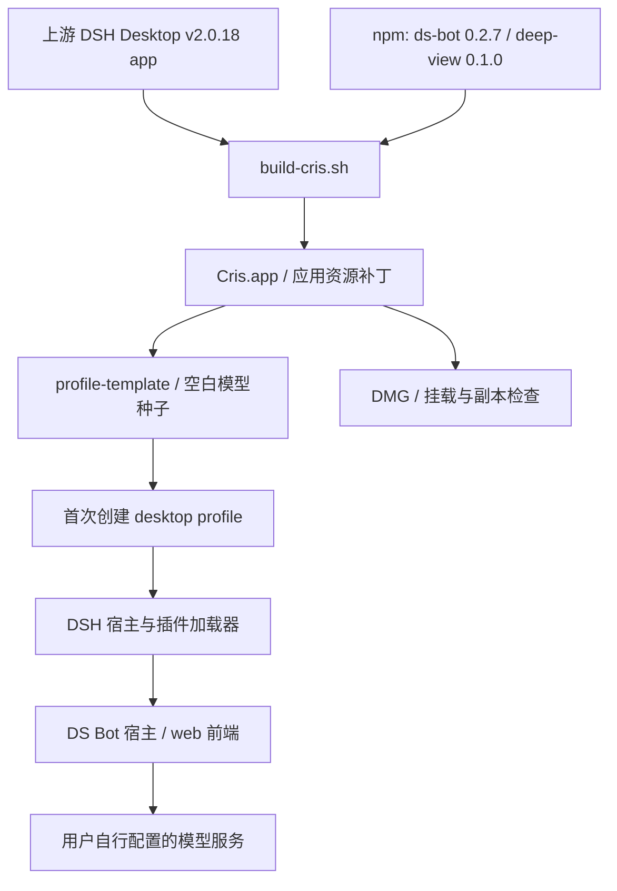

# 架构与构建过程

## 项目处在哪一层

Cris 的长期方向是带有 DS Bot 入口的桌面个人助手。本仓库交付的是对已构建桌面应用的打包后处理工具。它不包含完整 DSH 源码、模型服务、用户数据，也不定义一套新的 Agent Runtime。

这张图表达预期链路。当前公开默认依赖安装在 H → I 处存在已确认的导入失败，见[支持矩阵](../SUPPORT_MATRIX.md)。图中的箭头不代表所有步骤都已通过运行验收。

## 组件职责

| 组件 | 职责 | 不承担的工作 |
| --- | --- | --- |
| DSH / DeepSeek Harness | 会话、工具与模型等基础运行能力 | 本仓库不重写其核心 |
| dsh-desktop | Electron 桌面壳、桌面设置和 profile 启动 | 本仓库不从源码完整重建它 |
| DS Bot | 长期 Bot、团队和聊天相关宿主与前端能力 | 插件上游能力不等于本仓库已全部测试 |
| Deep View | 随 DS Bot 引入的界面相关依赖 | 不是本项目自研组件 |
| `build-cris.sh` | 应用复制、补丁、模板、DMG | 不提供模型账户或正式签名 |
| `verify-artifact.sh` | 局部结构和配置检查 | 不证明插件加载、UI、严格签名或隐私安全 |
| `publish-gate.sh` | 文本与路径规则、部分历史检查 | 不替代独立全面审查或二进制审核 |

## 当前脚本的变更面

1. 将源应用复制到目标路径；**现有同名目标会被删除**。
2. 在 `Contents/Resources/profile-template/` 组装依赖、空白 `cordis.patch.yml` 与清单。
3. 修改 `@deepseek-ai/dsh-app-boot`，注册 `cris` 模板，并在 `initProfile` 中复制模板内容。
4. 修改匹配到的 `profile-manager-*.js`，使桌面创建 profile 时选取 Cris 模板。
5. 修改更新模块及部分 URL，将更新入口禁用或换为 `.invalid` 占位域名。
6. 清理匹配的备份文件并检查部分资源中是否出现用户目录路径。
7. 尝试清除扩展属性与 ad-hoc 签名；当前签名失败仅告警。
8. 准备 DMG 暂存目录、创建镜像、挂载检查，再复制应用执行结构检查。

补丁依赖特定代码字符串和内部文件布局。上游版本变化会使锚点失效；不能通过去掉断言来获得兼容性。

## Profile 与配置分层

- 应用资源中的 `profile-template` 是待复制的**模板**。
- 运行时 profile 是用户数据目录中的 `profiles/desktop/`，二者不是同一目录。
- profile 的 `package.json` 中 `dsh.profile.bundles` 决定所选择的 bundle。
- 每个 bundle 可通过自己的 `dsh.bundle.patch` 声明提供配置层。
- profile 内 `cordis.patch.yml` 是用户覆盖层；没有直接出现 DS Bot 条目，并不能证明 bundle 没加载。
- Node 能 `require.resolve` 某个包，只能证明路径可找到，不保证导出/API 匹配，也不保证插件激活。

当前配置与实际优先级以目标 DSH 版本代码为准。本仓库没有另行承诺完整配置合同。

## 已确认的依赖遮蔽

默认 `npm install` 可能在 profile 模板中自动补装宿主 peer。已测到的 `dsh-llm@0.0.1-rc.5` 可被解析，但不导出 DS Bot 需要的 `createSystemMessage`；桌面内嵌的 `0.2.1-rc.2` 有该导出。因此“找到包”与“找到正确宿主 API”是两个检查。

独立试验采用限定 DS Bot / Deep View 的宿主解析方式，同时保留其他插件的旧依赖。正式方案仍需接收代码、移动后验证、新旧 profile 验收和公开审查。不能简单把整个用户 `@deepseek-ai` 目录覆盖成桌面依赖。

## 应用身份与隔离

输出名称、`CFBundleIdentifier`、`CFBundleExecutable`、Electron `userData`、`appData` 和 DSH 数据根目录是不同维度。当前 `--name` 不能将它们全部隔离。

单实例锁、已保存的数据目录选择和跨发行版状态清理都可能关联旧安装。仅设置 `DSH_HOME` 不足以证明测试副本不访问旧数据。测试应核对完整启动路径；需要更强隔离时使用独立测试账户或虚拟机，不把无法证明的隔离写为通过。

## 未来扩展

Windows、完整源码构建、跨平台初始化与更新服务需要独立设计，不能把 Bash 中的 macOS 命令逐字替换后就宣布支持。优先级和准入条件见[路线图](ROADMAP.md)。
